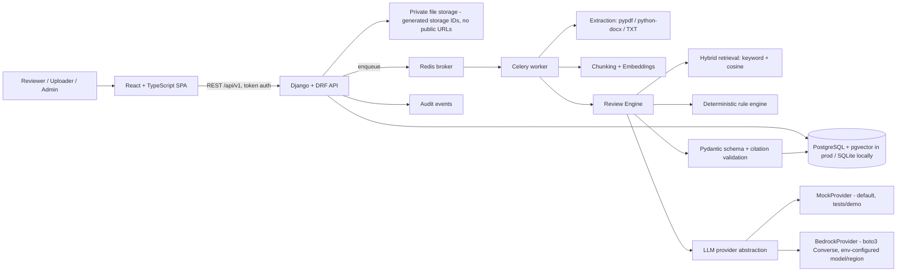

# Architecture

## Layers
- **Views** only authenticate, authorize (organization-scoped querysets), validate input and serialize. Business logic lives in `backend/services/`.
- **Services**: `extraction`, `chunking`, `embeddings`, `retrieval`, `llm`, `prompts` (versioned), `schemas` (Pydantic v1.0 contract), `validation` (citation checks), `rules` (deterministic checks + priority scoring), `review_engine`, `evaluation`.
- **State machine**: Document `uploaded → queued → extracting → indexing → reviewing → completed | failed`. Failed is terminal-honest: a failure is never rewritten as success.
- **Idempotency**: `process_document` no-ops when a document is already completed with chunks, and clears partial chunks before re-indexing on retry. `run_review` returns the existing result if one already exists for the job; duplicate queued/running review requests for the same document+policy return the existing job.
- **Retrieval**: chunks are always fetched through an organization-scoped queryset first (tenant filter before ranking). Ranking is 50% keyword overlap + 50% embedding cosine in Python, which works identically on SQLite and PostgreSQL. For production scale on PostgreSQL, enable pgvector (`CREATE EXTENSION vector;`), store embeddings in a `vector` column and replace the Python cosine pass with an `<=>` distance query — the provider interface does not change.
- **Prompts**: system prompt and prompt version (`review-v1`) are versioned in code; every `AIReviewResult` stores model ID, prompt version and schema version so old results stay interpretable.
